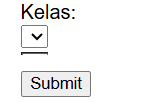

# TODO: Fix Create User Kelas Dropdown Bug

## Steps to Complete:

1. **Run KelasSeeder**: Execute `php artisan db:seed --class=KelasSeeder` to insert sample kelas data (A, B, C, D) into the database.
   - Status: Done

2. **Verify Dropdown**: Navigate to the create user page and confirm the kelas dropdown now shows options.
   - Status: Pending

3. **Check DatabaseSeeder**: Review database/seeders/DatabaseSeeder.php to ensure it calls KelasSeeder. If not, update it.
   - Status: Done (Updated to call KelasSeeder::class)

4. **Test Form Submission**: Create a test user and verify it saves correctly with selected kelas_id.
   - Status: Pending

After all steps are marked as done, the task is complete.
